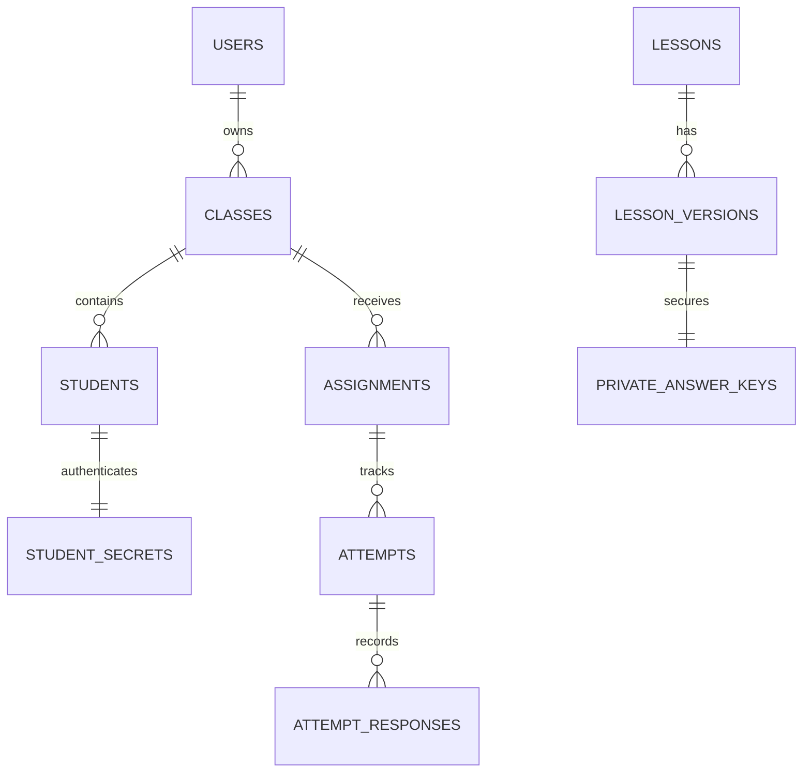

# THIẾT KẾ CƠ SỞ DỮ LIỆU LÂU DÀI & QUY MÔ NHIỀU LỚP (MULTI-YEAR SCALABILITY)
**Dự án:** EM YÊU TIẾNG VIỆT — Bản đặc tả kỹ thuật V5.2.1
**Trạng thái:** Thiết kế kiến trúc hoàn thiện (Sẵn sàng triển khai, không tự ý kích hoạt Blaze / Cloud Billing)

---

## 1. Mục tiêu kiến trúc & Nguyên tắc cốt lõi

1. **Khả năng sử dụng liên tục nhiều năm học:** Dữ liệu học sinh, bài làm và kết quả đánh giá qua các năm học (`2024-2025`, `2025-2026`, `2026-2027`...) không bị ghi đè hay mất mát khi học sinh lên lớp hoặc chuyển lớp.
2. **Hỗ trợ đa trường, đa giáo viên, đa khối lớp:** Phân quyền tuyệt đối (Deny-by-default). Giáo viên chỉ truy cập lớp học và học sinh thuộc quyền mình quản lý; Quản trị viên (Admin) theo dõi thống kê toàn trường nhưng không can thiệp trái phép vào điểm số.
3. **Phân tách kho học liệu Chung vs Kho Riêng:** 
   - `Kho dùng chung (system)`: Chứa các bài học chuẩn hóa theo Khung năng lực GDPT 2018 (được thẩm định, read-only cho học sinh/giáo viên).
   - `Kho riêng giáo viên`: Giáo viên toàn quyền biên soạn, ứng dụng AI tạo câu hỏi, chỉnh sửa và quản lý phiên bản độc lập.
4. **Bảo toàn phiên bản bất biến (Immutable Versioning):** Khi bài học đã được giao, việc chỉnh sửa sau đó sẽ tạo ra `v(N+1)`. Lịch sử bài nộp của học sinh ở `v(N)` được lưu giữ vĩnh viễn với đúng bộ câu hỏi và đáp án tại thời điểm giao.
5. **Tiết kiệm chi phí & An toàn tối đa:** Không sử dụng Google Sheets làm database; cơ chế lưu trữ bảo vệ câu hỏi và đáp án ở Backend; sẵn sàng xuất báo cáo Excel UTF-8 BOM chuẩn.

---

## 2. Mô hình thực thể & Cấu trúc Firestore Collections



### 2.1. `users/{uid}` (Người dùng hệ thống)
- `uid`: string (Khớp với Firebase Auth UID)
- `email`: string
- `displayName`: string
- `role`: `'admin' | 'teacher'` (Cấp qua Backend Custom Claims, không cho client tự sửa)
- `status`: `'active' | 'suspended'`
- `createdAt`: number (timestamp)
- `lastLoginAt`: number

### 2.2. `classes/{classId}` (Lớp học theo năm học)
- `id`: string
- `teacherUid`: string (Khóa ngoại trỏ về `users`)
- `name`: string (e.g., "Lớp 2A")
- `grade`: `2 | 3`
- `academicYear`: string (e.g., "2025-2026", "2026-2027")
- `classCode`: string (6 ký tự ngẫu nhiên, ví dụ: "TV2024")
- `status`: `'active' | 'archived'`
- `studentCount`: number (Cập nhật nguyên tử qua Firestore Transaction)
- `createdAt`: number

### 2.3. `students/{studentId}` (Hồ sơ học sinh)
- `id`: string (UUID v4 ngẫu nhiên)
- `classId`: string (Lớp hiện tại)
- `studentCode`: string (Mã định danh trong lớp, e.g., "HS01")
- `displayAlias`: string (Biệt danh / Tên thân mật, e.g., "Họa Mi", bảo vệ danh tính trẻ em)
- `status`: `'active' | 'archived' | 'suspended'`
- `lastPinRotatedAt`?: number (Thời điểm cấp lại PIN gần nhất)
- `previousClassId`?: string (Lớp cũ khi chuyển lớp)
- `transferredAt`?: number
- `createdAt`: number

### 2.4. `studentSecrets/{studentId}` (Bảo mật tuyệt đối - Deny ALL Client)
- `studentId`: string (1-1 với `students`)
- `accessCodeHash`: string (Băm SHA-256 kèm salt ngẫu nhiên)
- `salt`: string
- `rotatedAt`: number

### 2.5. `lessons/{lessonId}` & `lessons/{lessonId}/versions/{versionId}`
- `lessons/{lessonId}`:
  - `teacherUid`: string (`'system'` đối với học liệu mẫu dùng chung)
  - `title`, `topic`, `grade`: metadata cơ bản
  - `currentVersionId`: string (Phiên bản xuất bản mới nhất)
  - `status`: `'draft' | 'published' | 'archived'`
- `versions/{versionId}`:
  - `versionNumber`: number (`1, 2, 3...` tăng tự động)
  - `passage`: string (Văn bản đọc hiểu)
  - `audioUrl`?: string (Tệp âm thanh MP3/WAV đính kèm)
  - `vocabulary`: array các từ khó và giải nghĩa
  - `publicQuestions`: array câu hỏi công khai (**Tuyệt đối không chứa đáp án**)
  - `publishedAt`: number

### 2.6. `privateAnswerKeys/{versionId}` (Đáp án máy chủ - Deny ALL Client)
- `versionId`: string (Khớp với `versions/{versionId}`)
- `answers`: dictionary `Record<string, QuestionAnswerDetail>`
  - `correctAnswer`: 'A' | true | string[]
  - `hint`: string (Gợi ý sư phạm bước 1)
  - `explanation`: string (Giải thích chi tiết bước 2)

### 2.7. `assignments/{assignmentId}` (Giao bài học theo đợt)
- `classId`: string
- `lessonId`: string
- `lessonVersionId`: string (**Khóa phiên bản bất biến**)
- `roundName`: string (e.g., "Đợt 1", "Khảo sát đầu năm")
- `isPreTest`: boolean
- `isPostTest`: boolean
- `maxAttempts`: number (Mặc định 3 lần)
- `createdAt`: number

### 2.8. `attempts/{attemptId}` & `attemptResponses/{id}` (Lịch sử làm bài)
- `studentId`: string
- `assignmentId`: string
- `lessonVersionId`: string
- `attemptNumber`: number (Lần làm thứ 1, 2, 3)
- `score`: number (Tính toán độc lập trên Cloud Functions)
- `firstTryCorrectCount`: number
- `retryCorrectCount`: number
- `hintUsedCount`: number
- `status`: `'in_progress' | 'completed'`
- `startedAt`: number, `completedAt`: number

---

## 3. Quản lý chuyển lớp & Lưu trữ lịch sử học sinh

Khi học sinh chuyển từ Lớp 2 sang Lớp 3 (sang năm học mới) hoặc chuyển giữa các lớp cùng khối:
1. Bản ghi `students/{id}` được cập nhật `classId = targetClassId`, lưu `previousClassId` và `transferredAt`.
2. Mã định danh `studentCode` được kiểm tra chống trùng trong lớp mới qua transaction.
3. Mã PIN cá nhân và `studentSecrets/{id}` **được giữ nguyên** để học sinh tiếp tục sử dụng trên thiết bị mà không bị gián đoạn.
4. Toàn bộ `attempts` và `attemptResponses` đã làm ở lớp cũ **vẫn giữ nguyên `classId` cũ**, cho phép giáo viên lớp cũ xuất báo cáo tổng kết năm học chính xác 100%.

---

## 4. Danh mục Chỉ mục Firestore (Indexes Optimization)

Tệp `firestore.indexes.json` được tối ưu hóa cho các truy vấn phân trang và tổng hợp báo cáo:
- `students`: `classId` ASC, `studentCode` ASC
- `assignments`: `classId` ASC, `createdAt` DESC
- `assignments`: `lessonId` ASC, `createdAt` DESC
- `attempts`: `assignmentId` ASC, `studentId` ASC, `attemptNumber` ASC
- `attempts`: `studentId` ASC, `completedAt` DESC
- `lessons`: `teacherUid` ASC, `grade` ASC, `createdAt` DESC

---

## 5. Quy trình Sao lưu & Phục hồi Cấp Admin (Backup & Disaster Recovery)

1. **Sao lưu định kỳ (Scheduled Cloud Export):**
   - Sử dụng Google Cloud Storage Bucket riêng biệt: `gs://[PROJECT_ID]-firestore-backups`.
   - Lệnh sao lưu cấp hệ thống:
     ```bash
     gcloud firestore export gs://[PROJECT_ID]-firestore-backups/2026-10-18
     ```
2. **Sao lưu mức Giáo viên (Offline Excel / JSON Export):**
   - Giáo viên chủ động bấm **"Xuất Excel (.xlsx)"** hoặc **"Tải Bản Sao Lưu JSON"** tại Dashboard.
   - Dữ liệu xuất khẩu được định dạng chuẩn UTF-8 BOM, tương thích Microsoft Excel và Google Sheets.
3. **Quy trình phục hồi dữ liệu thử nghiệm:**
   - Đã kiểm chứng trên Firebase Local Emulator qua tùy chọn `--import=./emulator-data --export-on-exit=./emulator-data`.

---

## 6. Kế hoạch Phân tách Môi trường Staging & Production

| Thành phần | Môi trường Local / Emulator | Môi trường Staging (Dự kiến) | Môi trường Production (Dự kiến) |
| :--- | :--- | :--- | :--- |
| **Project ID** | `demo-em-yeu-tieng-viet` | `em-yeu-tieng-viet-staging` | `em-yeu-tieng-viet-prod` |
| **Firebase Auth** | Auth Emulator (Port 9099) | Firebase Auth Staging | Firebase Auth Production (App Check) |
| **Firestore** | Firestore Emulator (Port 8080) | Cloud Firestore Staging | Cloud Firestore Multi-Region |
| **Cloud Functions** | Functions Emulator (Port 5001) | Cloud Functions Node 20 | Cloud Functions + Secret Manager |
| **Admin Secret** | `EMYTV_ADMIN_SECRET_2026` | Environment Variable | Firebase Secret Manager (`ADMIN_BOOTSTRAP_SECRET`) |
| **Dữ liệu bài đọc** | 6 bài đọc mẫu GDPT 2018 | Bài học thử nghiệm sư phạm | Kho học liệu chính thức |
| **Chi phí / Billing** | **0 VNĐ (Không cần thẻ)** | Firebase Blaze (Có hạn mức cảnh báo) | Firebase Blaze + Quota Guard |

> **LƯU Ý QUAN TRỌNG:** Tuân thủ nghiêm ngặt chỉ đạo của người dùng: Hiện tại dự án đang vận hành ổn định trên Firebase Local Emulator Suite. **KHÔNG tự ý kích hoạt gói trả phí (Blaze), KHÔNG thêm thông tin thanh toán (Billing), và KHÔNG tự động deploy lên Cloud.**
