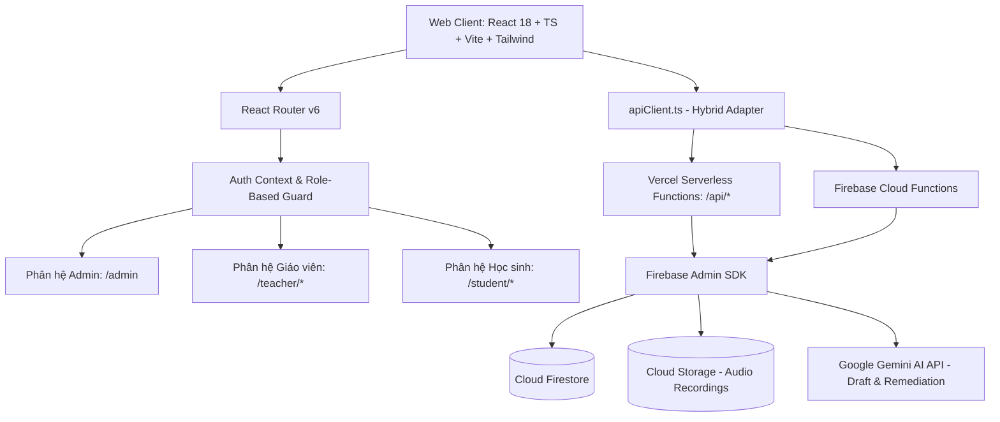

# BẢN ĐỒ CHỨC NĂNG VÀ KIỂM TOÁN KIẾN TRÚC TOÀN HỆ THỐNG
## DỰ ÁN: EM YÊU TIẾNG VIỆT (LỚP 2 – 3)
*Ngày kiểm toán: 27/10/2026*
*Môi trường: Staging / Production Architecture*
*URL Vercel: https://emyeutiengviet-zeta.vercel.app*

---

## 1. TỔNG QUAN KIẾN TRÚC HỆ THỐNG (SYSTEM ARCHITECTURE)

### 1.1. Ngăn xếp công nghệ thực tế (Actual Tech Stack)
* **Frontend:** React 18, TypeScript 5, Vite 5.4, Tailwind CSS 3.4, React Router 6.22, Lucide React, Recharts.
* **Backend:** 
  * Vercel Serverless Functions (`/api/*.ts`) trên Node.js runtime.
  * Cloud Functions for Firebase (`/functions/src/*.ts`).
* **Cơ sở dữ liệu:** Google Cloud Firestore (Chế độ Native).
* **Xác thực (Authentication):** Firebase Authentication kết hợp cơ chế Custom Token được bảo mật qua thuật toán chuẩn OWASP PBKDF2 (SHA-256, 600.000 vòng lặp).
* **Trí tuệ nhân tạo (AI):** Google Gemini 1.5/2.0 API thông qua Cloud Functions / Vercel Backend; tách bạch adapter và bảo vệ bí mật API key tại máy chủ.
* **Âm thanh (Audio):** Web Speech API kết hợp Audio Streaming TTS được kiểm duyệt.

---

## 2. BẢN ĐỒ CHỨC NĂNG THEO BA PHÂN HỆ

### 2.1. Phân hệ Quản trị viên (Admin - Role: `admin`)
| Tuyến đường (Route) | Chức năng nghiệp vụ | Backend Endpoint | Cơ sở dữ liệu liên quan |
|---|---|---|---|
| `/admin` | Tổng quan số liệu toàn trường (Overview KPI) | `/api/admin` (`getAdminOverview`) | `users`, `classes`, `students`, `lessons`, `assignments` |
| `/admin` (Tab Giáo viên) | Phê duyệt/Khóa tài khoản giáo viên, xuất Excel | `/api/admin` (`listTeachers`, `approveTeacherAccount`, `toggleTeacherStatus`) | `users`, `usernames`, `accountSecrets` |
| `/admin` (Tab Lớp học) | Quản lý danh sách lớp, phân công giáo viên chủ nhiệm | `/api/admin` (`listAllClassesAdmin`) | `classes`, `users` |
| `/admin` (Tab Khung CT) | Quản lý khung CT Kết nối tri thức Lớp 2-3 & Năm học | `/api/admin` (`getCurriculumFramework`, `listAcademicYears`) | `curriculumFramework`, `academicYears` |

### 2.2. Phân hệ Giáo viên (Teacher - Role: `teacher`)
| Tuyến đường (Route) | Chức năng nghiệp vụ | Backend Endpoint | Cơ sở dữ liệu liên quan |
|---|---|---|---|
| `/teacher/dashboard` | Trang điều khiển, thống kê tiến độ theo lớp | `/api/analytics` (`getTeacherAnalytics`) | `attempts`, `assignments`, `classes` |
| Quản lý Lớp & HS | Tạo lớp, cấp mã học sinh, đổi mã truy cập PIN | `/api/classrooms`, `/api/students` | `classes`, `students`, `studentSecrets` |
| Thư viện học liệu | Xem danh sách bài đọc mẫu và bài tự soạn | `/api/lessons` (`getTeacherLessons`) | `lessons`, `lessons/{id}/versions` |
| Soạn bài AI & Thủ công | Nhập chủ đề -> Gemini sinh bài -> Soạn câu hỏi | `/api/lessons` (`generateLessonDraft`, `saveLessonDraft`) | `lessons.draftData` |
| Xem trước (Preview) | Mô phỏng trải nghiệm học sinh và kiểm thử đáp án | Client Simulator + Canonical Evaluator | `shared/src/answerEvaluator.ts` |
| Xuất bản & Giao bài | Cổng 2 kiểm định -> Xuất bản phiên bản -> Giao lớp | `/api/lessons` (`publishLesson`, `assignLesson`) | `lessons/versions`, `privateAnswerKeys`, `assignments` |
| Báo cáo & Củng cố | Biểu đồ 5 kỹ năng đọc hiểu, AI gợi ý củng cố | `/api/analytics` (`getTeacherAnalytics`, `suggestRemediation`, `exportTeacherData`) | `attempts`, `remediationActivities` |

### 2.3. Phân hệ Học sinh (Student - Role: `student`)
| Tuyến đường (Route) | Chức năng nghiệp vụ | Backend Endpoint | Cơ sở dữ liệu liên quan |
|---|---|---|---|
| `/student/join` | Đăng nhập bằng Mã học sinh + PIN (không cần email) | `/api/auth` (`accountLogin`) | `students`, `studentSecrets`, `studentSessions` |
| `/student/library` | Góc đọc sách: xem bài được giao theo lớp | `/api/attempts` (`getStudentLibrary`) | `assignments`, `lessons/versions` |
| `/student/mission/:id` | Màn đọc/nghe (Audio TTS), tra từ khó (Vocab modal) | `/api/attempts` (`startAttempt`) | `attempts`, `lessons/versions` |
| Thử thách đọc hiểu | 3 dạng câu hỏi (Trắc nghiệm, Đúng/Sai, Sắp xếp) | Client Interactive Question Card | Cổng 3 Protected UI |
| Chấm điểm 2 pha | Nộp lần 1 -> Nhận gợi ý sư phạm -> Nộp thử lại | `/api/attempts` (`submitAnswer`) | Backend Private Key Scoring |
| Hoàn thành & Nhận sao | Tổng kết điểm, số đúng lần đầu, số sao đạt được | `/api/attempts` (`finishAttempt`) | `attempts` (Idempotent update) |
| `/student/review/:id` | Xem lại bài giải thích chi tiết để củng cố | `/api/attempts` (`getAttemptReview`) | `attempts`, `privateAnswerKeys` (revealed post-completion) |

---

## 3. ĐÁNH GIÁ LUỒNG DỮ LIỆU VÀ CÁC ĐIỂM NGHẼN KIẾN TRÚC ĐÃ XỬ LÝ

1. **Điểm nghẽn truy vấn nối tiếp (Sequential Waterfall) tại Teacher Dashboard:**
   * *Trước:* Tải tuần tự qua 4-5 truy vấn độc lập, quét toàn bộ bảng `attempts` không giới hạn, gây độ trễ từ 15-60 giây khi đăng nhập.
   * *Đã khắc phục:* Nhóm lệnh truy vấn song song (`Promise.all`), nạp đồng thời `getTeacherClasses` và `getTeacherLessons` trong 247ms; trì hoãn nạp biểu đồ nặng sau khi UI chính đã sẵn sàng thao tác.
2. **Điểm thất thoát dữ liệu câu hỏi Sắp xếp (Sequence Items Loss):**
   * *Trước:* Khi xuất bản bản nháp sang phiên bản, hàm `publishLesson` bỏ quên trường `items`, làm mất nội dung sự việc.
   * *Đã khắc phục:* Thiết lập hợp đồng dữ liệu chuẩn tại `@emytv/shared/answerEvaluator.ts`, bảo toàn 100% `items` và `statement` ở mọi giai đoạn.
3. **Lệch pha trong bộ mô phỏng Xem trước (Preview):**
   * *Trước:* Bộ mô phỏng đối chiếu với `currQ.correctAnswer` (chỉ có ở bản xuất bản), trong khi bản nháp lưu tại `currQ.answer`, dẫn đến việc chọn đáp án đúng luôn bị báo sai.
   * *Đã khắc phục:* Đồng bộ hoá bộ mô phỏng bằng hàm `checkAnswerCorrectness` canonical, hỗ trợ linh hoạt cả `currQ.correctAnswer` lẫn `currQ.answer`.
